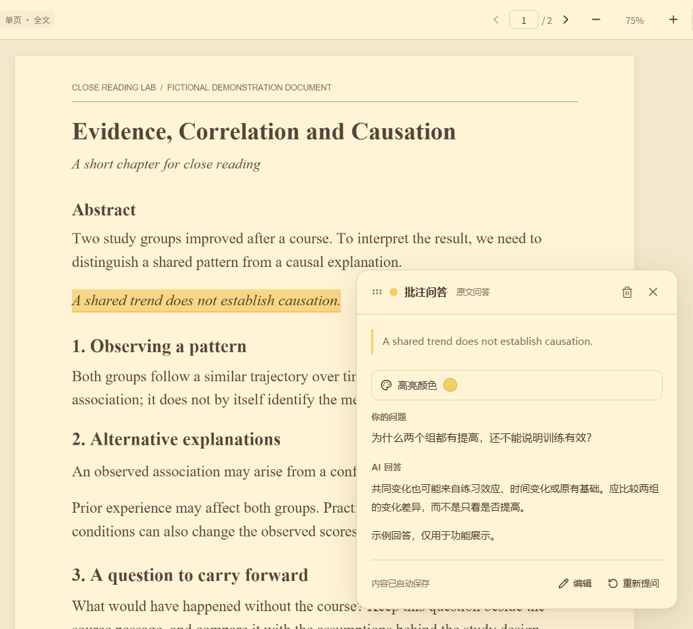
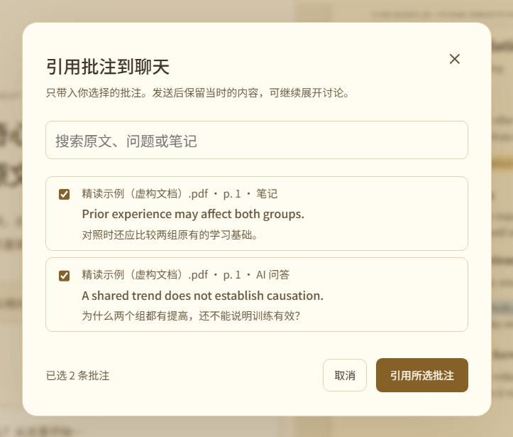
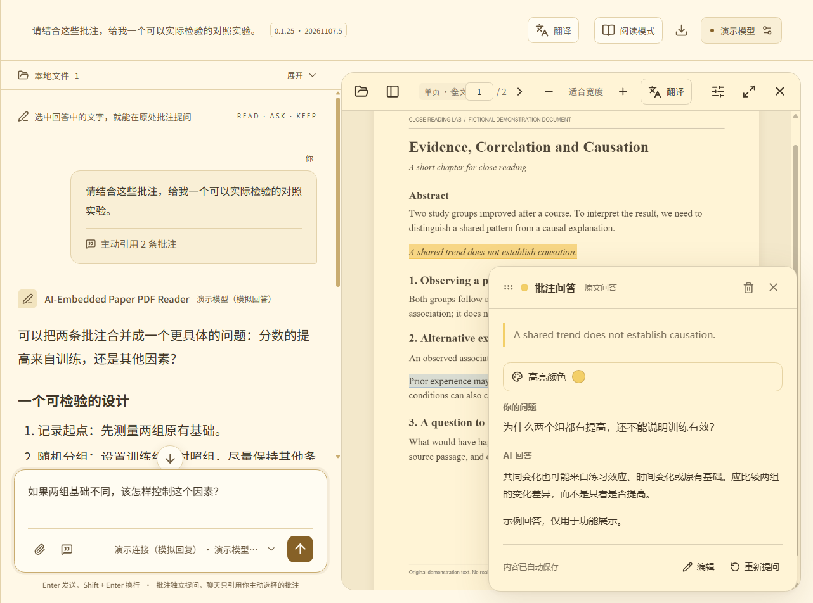
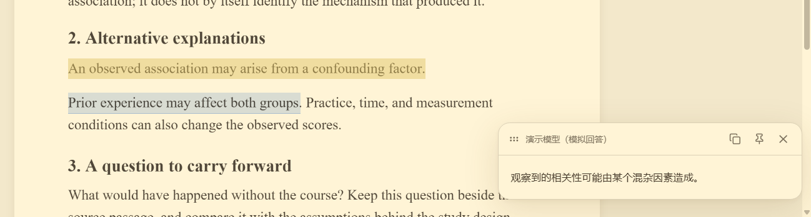

# AI-Embedded Paper PDF Reader

**AI 嵌入式论文 PDF 阅读器**

读论文时，你是否也厌倦了在 PDF 和 AI 聊天窗口之间来回切换？想回顾某个概念的解释，却又得在冗长的对话里反复翻找？

**面向文献与书籍精读：接入自己的 API，把批注提问与快速翻译留在原文旁。**

这是一个支持本地 PDF、EPUB、MOBI 和 AZW3 的桌面精读器，适合逐段理解论文的概念、公式与论证，也适合精读教材、专业书籍和外语电子书。你可以连接自选的 AI 服务、中转 API，或自行部署的本地模型服务；划选原文，在批注框里提问、查看回答，或快速翻译选中的单词和段落。需要把某个疑问展开讨论时，选择引用已有批注，在聊天中继续追问，同时对照 PDF 和原文批注。纸张与文字颜色可以自由调整。

Tired of switching back and forth between a paper and an AI chat window? Or scrolling through a long conversation just to find an explanation you want to revisit?

**Close reading for papers and ebooks, with your own API, annotation Q&A and quick translation beside the source.**

A desktop reader for local PDFs and DRM-free EPUB, MOBI and AZW3 ebooks. Work through a paper's concepts, equations and arguments, or study textbooks, technical books and foreign-language ebooks in detail. Connect your preferred AI provider, relay API or self-hosted model service. Select a passage to ask in its annotation panel or quickly translate a word or paragraph. To develop a question further, reference selected annotations in chat while keeping the PDF and its original note in view. Adjust paper and text colors to your preference.

[发布记录 / Releases](https://github.com/Eatastar/AI-Embedded-Paper-PDF-Reader/releases) · [版本说明 / Release notes](docs/RELEASE_NOTES.md) · [隐私 / Privacy](docs/PRIVACY.md) · [版本记录 / Changelog](docs/CHANGELOG.md) · [项目总纲 / Project outline](docs/PROJECT.md)

## 下载 v0.1.45 / Download v0.1.45

| Windows | Linux（预览 / Preview） | macOS（便携试用 / Portable preview） |
| --- | --- | --- |
| [x64 ZIP](https://github.com/Eatastar/AI-Embedded-Paper-PDF-Reader/releases/download/v0.1.45/AI-Embedded-Paper-PDF-Reader-0.1.45-Windows-x64.zip) | [x64 tar.gz](https://github.com/Eatastar/AI-Embedded-Paper-PDF-Reader/releases/download/v0.1.45/AI-Embedded-Paper-PDF-Reader-0.1.45-Linux-x64.tar.gz) | [Apple 芯片 / Apple silicon](https://github.com/Eatastar/AI-Embedded-Paper-PDF-Reader/releases/download/v0.1.45/AI-Embedded-Paper-PDF-Reader-0.1.45-macOS-arm64.zip) · [Intel](https://github.com/Eatastar/AI-Embedded-Paper-PDF-Reader/releases/download/v0.1.45/AI-Embedded-Paper-PDF-Reader-0.1.45-macOS-x64.zip) |

支持八种界面语言，可在程序内切换并在本机记忆。程序与个人资料分开保存。[更新与数据保留](docs/UPDATING.md)

Choose from eight interface languages. The app remembers your choice locally. Program files are separate from your profile. [Updates and your data](docs/UPDATING.md)

首页左上角“菜单”可直接进入设置、API 连接、翻译设置、聊天、备份恢复和回收站，无需先打开 PDF。完整 JSON 备份包含聊天、笔记、批注和已导入的 PDF / 电子书原文件，不含 API 连接配置与密钥。

The top-left Menu on the start page opens settings, API connections, translation settings, chats, backup and restore, and trash without opening a PDF. A full JSON backup includes chats, notes, annotations and original imported PDF/ebook files; it excludes API connection profiles and keys.

自动备份按内容共享 PDF 等附件，多个恢复点只保存一份相同文件；旧自动备份会在校验成功后转换。手动导出的 JSON 仍包含原文件，可单独恢复。[备份与空间说明](docs/PERFORMANCE.md)。

Automatic backups share identical PDF and other attachments across recovery points; older automatic backups are converted after verification. Manually exported JSON still includes the original files and can be restored on its own. [Backup storage details](docs/PERFORMANCE.md).

聊天和批注照常及时保存；历史备份按 10 分钟间隔、手动操作及正常退出建立。备份列表支持逐条删除，包括升级前恢复点；删除备份不影响当前资料。

Chats and annotations keep saving promptly. Historical backups are created at 10-minute intervals, manually, and on normal exit. Individual backups, including pre-upgrade points, can be deleted without removing current data.

EPUB/MOBI/AZW3 按章节显示，不把整本书转换成 PDF 或页面截图；原书只保存一份，章节图片和字体在切章或关闭时释放。大书沿用按需引用，小书默认全文。图片框选问答目前用于 PDF；电子书本版提供原文文字批注与翻译。只支持无 DRM 文件，不解密受保护的商业电子书。

EPUB/MOBI/AZW3 are rendered chapter by chapter without converting whole books to PDFs or page images. Store one original archive and release chapter image/font resources on chapter changes or close. Large books use relevant excerpts; small books default to full text. Figure-region Q&A is currently a PDF feature; ebook support in this version covers text annotations and translation. DRM-protected commercial ebooks are not decrypted.

## 精读场景 / Close-reading workflows

以下图片取自实际运行的 v0.1.25 客户端，展示真实的批注、引用、聊天和翻译界面。拍摄使用独立演示资料、虚构 PDF 和本地模拟回复，部分图片裁切到相关区域以便查看。日常使用中的回答和译文由你配置的模型生成。

These are screenshots of the running v0.1.25 client, showing its actual annotation, reference, chat and translation interfaces. They use an isolated demonstration profile, a fictional PDF and local mock responses; some captures are cropped for clarity. In normal use, answers and translations come from the model you configure.

### 1. 在原文旁批注提问 / Ask beside the passage



读论文或书籍时，把不懂的概念、公式和论证留在对应原文旁处理。批注收起后保留高亮，之后点击即可重新打开，也可以只写普通笔记。

Work through unfamiliar concepts, equations and arguments beside their source. A closed annotation leaves a highlight you can reopen later; plain notes are available too.

### 2. 引用批注，继续追问 / Reference annotations in chat



点击聊天输入框中的“引用批注”，勾选这次需要的问答或笔记，再补充问题发送。适合把几处阅读疑问联系起来，做比较、归纳或进一步推导。

Use Reference annotations in the composer, select the Q&A or notes you need, and add your next question. Connect questions from different passages to compare ideas, summarize or work through a derivation.

也可以直接在文字、图片或笔记批注底部点击“引用到聊天继续追问”：打开聊天并带上这条批注，保留输入草稿，再由你补充问题发送。

You can also choose Reference in chat and ask further below a text, figure or plain-note annotation. Open chat with that annotation selected, keep the composer draft and add your next question before sending.

### 3. 边聊边对照 PDF 批注 / Discuss with the PDF and note in view



把聊天与 PDF 并排打开，在聊天中展开长问题，同时查看原文和已打开的批注。点击聊天或正文不会关闭批注；用 × 或 Esc 收起，继续沿着原文阅读。

Open chat beside the PDF for a longer discussion while consulting the source passage and its annotation. Clicking chat or the source keeps the note open; close it with × or Esc and continue reading.

### 4. 划词快速翻译 / Translate a selection quickly



外语文献和书籍中，选中单词或一段文字，按默认 **Alt+1** 或右键翻译。临时面板只显示译文和对应模型；需要留下时，点击图钉保留为普通批注。翻译 API、提示词和快捷键均可单独设置，调用时只发送选段及翻译提示词。

For foreign-language papers and books, select a word or passage and press **Alt+1** or right-click to translate. The temporary panel shows the translation and its model; pin it to keep a plain note. Configure the translation API, prompt and shortcut separately. Only the selection and translation prompt are sent.

## 主要功能 / Main features

| 功能 | Feature |
| --- | --- |
| **阅读本地 PDF**：保留论文原排版，支持连续滚动、单页阅读、目录、全文搜索、手势缩放和阅读位置记忆。 | **Read local PDFs** with their original layout, continuous or single-page reading, contents, full-text search, pinch zoom and reading position memory. |
| **精读电子书**：打开无 DRM 的 EPUB、MOBI、AZW3；用工具栏 **Aa 排版** 调字号、行距和宽度。双指、Ctrl+滚轮或加减按钮整体缩放，保持当前换行；按书记住排版与位置。支持目录、搜索、原文链接、笔记、AI 批注问答、引用聊天及划词翻译。 | **Read ebooks closely**: open DRM-free EPUB, MOBI and AZW3. Use **Aa Typography** to adjust font size, spacing and width. Pinch, Ctrl+wheel or +/− scales the page while keeping line breaks. Typography and progress are remembered per book. Use contents, search, internal links, notes, annotation Q&A, chat references and quick translation. |
| **自定义纸张颜色**：调节 PDF 纸张和文字颜色，阅读区及工具栏随之配色；保留彩图并可切回原色对照。减少刺眼白底，方便畏光或对明亮屏幕敏感的读者按个人感受调整。 | **Customize paper colors**: adjust PDF paper and text colors, with matching reader controls and margins. Preserve colored figures and compare with original colors. Reduce bright white backgrounds and tailor the display for readers with light sensitivity, including photophobia. |
| **在批注中询问 AI**：划选原文就地提问，问答与来源文字绑定；收起后保留高亮，点击即可重开。支持自选高亮颜色、重新提问，也可只写普通笔记。 | **Ask AI in annotations**: select a passage and ask in place, keeping the Q&A attached to its source. Close the panel and click the highlight to reopen it. Choose highlight colors, ask again or write a plain note. |
| **图片批注问答**：框选图表，默认画圈或切换画笔标出疑问，使用自选视觉 API 在原图旁提问；选区、圈画与问答保存到本机。 | **Image Q&A annotations**: select a figure, circle or draw on a detail, and ask your chosen vision API beside the source. Region, markings and Q&A are saved locally. |
| **划词翻译**：选中单词或段落，右键或按 Alt+1 即可翻译，在原文旁查看译文。可独立选择 API、自定义提示词与快捷键；只发送选段及翻译提示词，译文可保留为普通批注。 | **Translate selected text**: select a word or passage and right-click or press Alt+1 to see its translation beside the source. Choose an independent API, customize the prompt and shortcut, and optionally keep the result as a plain note. Only the selection and translation prompt are sent. |
| **按需打开聊天模式**：需要进一步讨论时展开聊天，收起后继续阅读，保留当前文档、位置和缩放。聊天回答中的文字也可添加批注。 | **Open chat when needed** for a longer discussion, then return to the same document, position and zoom. Text in AI answers can also be annotated. |

聊天模式左下角“设置”可切换界面语言、查看快捷键并管理模型/API 连接。

Use Settings at the bottom left of chat to choose the interface language, view shortcuts and manage model/API connections.

## 图片提问 / Ask about a figure

在 PDF 工具栏点击“框选图片”或按 **Ctrl+Alt+A**，选中整幅图及坐标、图例或图注，在紧凑批注中点击“圈出疑问”。默认画圈，也可选择画笔、颜色和粗细，支持撤销与清空。保留圈画后输入问题，选择已保存的视觉模型连接即可提问。点击缩略图可临时放大，默认侧栏宽度约 280–320px；窄窗口移到页面下方。批注可拖动，用 × 或 Esc 收起，再点原图选区重新打开。

Choose Select image in the PDF toolbar or press **Ctrl+Alt+A**, include the figure with its axes, legend or caption, then choose Circle a detail in the compact annotation. Circle is the default; pen, colors, widths, undo and clear are available. Keep the markings, enter a question and select a saved image-capable connection. Click the thumbnail to enlarge it. The default panel is about 280–320px wide and moves below the page in narrow windows. Drag the panel or close it with × or Esc; click its source region to reopen it.

只有主动发送图片问题时，才向所选连接发送本次原始配色选图、圈画、问题及所属文档的文字资料；小文件默认全文，大文件按需引用，不带聊天及其他批注。重新提问成功后才替换原问答和圈画。明确只支持文字的连接可在设置中标记并提前阻止请求；未知能力依据上游明确错误提示，不会自动发送测试图片或产生探测调用。

Only sending an image question transmits its original-color crop, markings, question and source-document text to the selected connection. Small files use full text and large files use relevant excerpts by default, without chat or other annotations. A successful re-question replaces the old Q&A and markings; failures keep them. Mark known text-only connections in settings to block image requests. Unknown capabilities are classified from explicit upstream errors, without automatic probe images or billable test calls.

保存和备份只新增文档关联、页码、相对选区及矢量笔迹，不为每条图片批注持久保存截图或 Base64。重新打开时从已保存 PDF 还原选图；原 PDF 仍按原附件机制保留。派生原色选图采用最多 32 MiB / 24 项的临时缓存，发送图片最多 1 MiB、最长边 1800px、200 万像素；活动预览、合成画布与 PDF 页面内存另计，收起或关闭后释放相应资源。图片批注备份请用 v0.1.26 或更新版本恢复。

Storage and backups add only the document association, page, normalized region and vector markings, without a persisted screenshot or Base64 copy for each annotation. Images are regenerated from the saved PDF; the original PDF remains an attachment. Derived original-color crops use a transient cache capped at 32 MiB / 24 entries. A transmitted image is capped at 1 MiB, 1800px per edge and two million pixels. Active previews, compositing canvases and PDF page memory are separate and released when no longer needed. Restore image-annotation backups with v0.1.26 or newer.

## 独立批注与聊天 / Independent annotations and chat

聊天发送尚未删除的有效主对话及所选文档资料，默认不读取批注；点击输入框下方工具栏“引用批注”后，只把手动选择的问答或笔记加入该次问题。PDF 批注只引用所属文档、选段和本次问题，不带聊天及其他批注；在 AI 回答上提问时，仅引用批注绑定的那一版原回答。

Chat sends the remaining valid main conversation and document material, without automatically reading annotations. Reference annotations in the composer toolbar adds only the Q&A or notes you select to that question. A PDF annotation uses only its own document, selection and current question, without chat or other annotations. An annotation on an AI answer uses only its bound original answer version.

聊天中可逐轮删除问题及回答，清除关联的旧请求缓存；PDF 原文批注保留。批注保留论文背景：小文件默认全文，大文件默认按需引用，也可在阅读设置中选择全文。

Delete individual chat rounds and their stale request caches while retaining PDF annotations. Annotations keep the paper background: full text for small files and retrieved excerpts for large files by default, with a full-text option in Reading settings.

## 并排阅读与文字引用 / Side-by-side reading and quotations

聊天模式关闭 PDF 后保持聊天可见，顶部“展开文档”及聊天文件名可一键恢复并排阅读，沿用原页码与缩放。左上角长项目名按侧栏宽度换行。选中 PDF、AI 回答或聊天问题中的文字，可通过浮动按钮或右键“引用到聊天”，在输入框预览选段、补充问题再发送，不创建批注或自动调用 API。每次引用一段，重新选择会替换待发送段落，可用 × 取消。

Closing a PDF in chat keeps the conversation visible. Open PDF at the top, or the file name in chat, restores side-by-side reading with the saved page and zoom. Long branding wraps inside the sidebar. Select text in a PDF, AI answer or chat question and use Quote in chat from the selection action or context menu, preview the excerpt, add a question and send. This creates no annotation and makes no automatic API call. One pending excerpt can be replaced or removed with ×.

批注在点击聊天、正文、翻页和切换阅读布局时保持打开，用 × 或 Esc 收起；编辑中的修改在关闭或切换来源时保存。切换文件或对话会收起批注。临时翻译继续保持原来的框外点击、Esc / × 关闭及滚动保留规则；同时展开时，Esc 优先关闭翻译。

Annotations stay open while clicking chat/source text, turning pages or changing reading layout; use × or Esc to close. Pending edits are saved when closing or leaving the source. Switching documents or conversations dismisses the annotation. Temporary translation retains outside-click, Esc/× dismissal and scroll retention; when both panels are open, Esc dismisses translation first.

## 自选 API，本地保存配置 / Your API, locally stored settings

**API 地址、模型配置和密钥保存在你的电脑上，不上传到项目方服务器。** 程序不提供项目方托管的密钥服务，也不附带可用密钥；你决定连接谁、使用哪个模型。Windows 桌面版使用系统加密保存密钥；系统加密不可用时，只在本次运行的内存中保留密钥，不写入明文密钥文件。密钥配置与聊天分开保存，不进入聊天备份；请求诊断日志不记录密钥或授权头。

**Your API endpoints, model settings and keys are stored on your computer, not uploaded to a project-operated server.** The app provides no project-hosted credential service or preloaded keys; you choose the service and model. The Windows desktop app encrypts saved keys using the operating system. If encryption is unavailable, keys stay in memory for that session rather than being written to a plaintext key file. Credentials are stored separately from conversations and excluded from conversation backups; diagnostic logs omit keys and authorization headers.

普通阅读、搜索、调色和笔记不调用 AI。**提问或获取模型列表时，密钥会发送给你配置的服务用于认证；提问还会发送相应的对话和文档提取文字。** 原 PDF 不作为文件上传。划词翻译只发送选段和翻译提示词。项目没有云端文件库、账号服务或使用情况收集接口。本地保存避免向项目方托管密钥，但安全性仍取决于你选择的服务和本机环境。完整的数据范围与代理说明见[隐私说明](docs/PRIVACY.md)。

Reading, search, recoloring and plain notes make no AI requests. **Asking a question or fetching models sends authentication to your configured service; questions also send the relevant conversation and extracted document text.** Original PDFs are not uploaded as files. Quick translation sends only the selection and translation prompt. The project has no cloud document library, account service or usage collection endpoint. Local storage avoids entrusting credentials to the project, but security still depends on your chosen service and computer. See [Privacy](docs/PRIVACY.md) for data scope and proxy behavior.

## 开始使用 / Getting started

1. 从 [Releases](https://github.com/Eatastar/AI-Embedded-Paper-PDF-Reader/releases) 下载 Windows x64 ZIP，**完整解压**后运行 `AI-Embedded-Paper-PDF-Reader.exe`，保留同目录所有文件。更新前先正常退出旧版。
   Download the Windows x64 ZIP from [Releases](https://github.com/Eatastar/AI-Embedded-Paper-PDF-Reader/releases), **fully extract it** and run `AI-Embedded-Paper-PDF-Reader.exe`, keeping all accompanying files. Exit the old app normally before updating.
2. 在首页点击“打开 PDF / 电子书”；在阅读设置中调整纸张和文字颜色。电子书右上角的 **Aa 排版** 可随时调整字号、行距和正文宽度。无需配置 API 即可阅读和写普通批注。
   Open a local PDF or ebook from the home screen and adjust paper/text colors in Reading settings. In ebooks, **Aa Typography** in the upper toolbar opens font size, spacing and text width controls. Reading and plain annotations work without an API connection.
3. 要使用 AI，在首页点击“配置 API”，填写服务地址和密钥，再“探测上游模型”。从列表选择实际调用的模型，点击“保存并使用”；服务不提供列表时可手动填写模型名称。
   To use AI, open API setup on the home screen, enter the endpoint/key and discover upstream models. Choose the actual model and Save and use, or enter its name manually if listing is unavailable.
4. 划选原文，选择“询问 AI”或“只写批注”。点击高亮重开批注；需要更长的讨论时，从阅读器工具栏打开聊天。
   Select text to ask AI or write a note. Click a highlight to reopen its panel, or open chat from the reader toolbar for a longer discussion.
5. 需要翻译时，选中文字后右键或按 **Alt+1**。误关译文后，只要原文仍可见，再按同一快捷键即可重译。右上角“翻译”按钮可设置 API、语言、提示词及快捷键；点击保留可把译文转为普通批注。
   Select text and right-click or press **Alt+1** to translate. After closing the result, press the same shortcut while the passage is still visible to translate it again. The Translate button configures the API, language, prompt and shortcut. Keep turns a translation into a plain note.

## 划词翻译与 PDF 链接 / Translation and PDF links

选中文字后右键翻译或按默认 Alt+1；右上角独立“翻译”按钮可设置目标语言、提示词、独立 API 及自定义快捷键。连接列表共用，翻译选择不切换聊天。只发送选段和翻译提示词，不发送全文、所在页或聊天历史。临时面板显示译文和模型，滚动和跨页时仍保留，可拖动位置；框外点击、Esc 或 × 关闭并丢弃，点击保留后才创建普通批注。翻译设置单独记在本机，不进入聊天备份。

Select text and right-click to translate or press Alt+1. The separate Translate button configures the target language, prompt, independent API and shortcut. Connections are shared without switching chat. Only the selection and translation prompt are sent, without full text, page or history. The movable temporary text/model panel stays open during scrolling and cross-page reading. Outside click, Esc or × discards it; Keep creates a plain note. Settings stay local outside conversation backups.

PDF 自带的参考文献和图号链接支持文内精确跳转，并可返回跳转前位置。HTTP/HTTPS 网页链接交由系统浏览器打开，不执行脚本或文件动作；没有原生链接的文字不猜测跳转。深色配色修正彩色字边缘的白色残影，原 PDF 不改写。

Embedded PDF references/figure links navigate to their page positions, with return navigation. HTTP/HTTPS links open in the system browser; scripts and file actions are not executed. No destination is guessed for unlinked text. Dark colors correct white halos around colored text without modifying the PDF.

## 连接与文档支持 / Connections and document support

- **自选模型服务**：支持 Chat Completions、Responses 和 Anthropic Messages 三种接口格式。提供 GPT、Claude、DeepSeek、中转站、Kimi、千问、Gemini 兼容入口、Grok、Ollama、LM Studio 及自定义模板。阅读器负责连接服务，模型服务本身需自行提供或部署。可用模型及权限由服务商决定。
  **Choose your model service** with Chat Completions, Responses or Anthropic Messages. Templates cover GPT, Claude, DeepSeek, relays, Kimi, Qwen, Gemini's compatible endpoint, Grok, Ollama, LM Studio and custom services. The reader connects to a service you provide or deploy; model availability and permissions depend on that service.
- **获取并选择上游模型**：读取服务的模型列表 API，按实际模型 ID 排序，可筛选并直接选择。连接名称只是本地备注，模型 ID 才是实际调用名称；未列出的模型仍可手动填写。
  **Discover and select upstream models** through the service's model-list API, with filtering and sorting by actual model ID. Connection names are local labels; the selected model ID is what the API receives. Manual entry remains available for unlisted models.
- **大文件按需引用**：PDF 支持最大 150 MiB、5000 页及 1000 万提取字符，打开时显示进度并可取消。默认小文件发送全文提取文字，大文件在本机查找相关段落后发送；可切换范围，原文件留在本机。扫描页可查看和换色，目前无 OCR 或图像理解。
  **Retrieve excerpts for large files**: PDFs support up to 150 MiB, 5,000 pages and 10 million extracted characters, with progress and cancellation. By default, small files contribute their full extracted text; large files contribute locally retrieved passages. The scope is adjustable and original files stay local. Scanned pages support viewing/recoloring, without OCR or image understanding.
- **保留阅读与批注成果**：支持批注定位、问答重新生成、回收站恢复与永久删除、完整备份和追加导入。重新提问成功后才替换旧批注问答，失败重试保留原请求资料。具体范围和容量限制见[客户端说明](outputs/client/README.md)。
  **Keep your reading and annotation work** with annotation navigation, regenerated answers, trash restore/permanent deletion, full backups and additive import. A new annotation answer replaces the previous one only after success; retries retain the original request material. See the [client guide](outputs/client/README.md) for scope and capacity limits.

## 自由修改与署名 / Adaptation and credits

欢迎任何人下载、使用、fork 本项目，并用 **AI agent / vibe coding** 修改成适合自己的版本。发布衍生版时，请在 README 或发布说明中链接[本项目](https://github.com/Eatastar/AI-Embedded-Paper-PDF-Reader)，例如“基于 AI-Embedded Paper PDF Reader 修改”。这是友好的来源标注请求，不增加 MIT 许可证之外的限制。

Everyone is welcome to download, use and fork this project, and adapt it with **AI agents / vibe coding**. Please link to [this project](https://github.com/Eatastar/AI-Embedded-Paper-PDF-Reader) when publishing a derivative, for example “Based on AI-Embedded Paper PDF Reader.” This is a courtesy request and adds no restrictions to the MIT license.

**本项目的原创应用代码全部由 GPT 通过 Codex 实现。人类发起者负责提出想法、确定需求，并对功能进行选择和取舍。** 第三方代码保留各自作者的版权、署名和许可证，不属于上述 GPT 原创声明。见[贡献说明](docs/ATTRIBUTION.md)和[第三方组件](docs/THIRD_PARTY.md)。

**All original application code was implemented by GPT through Codex. The human initiator proposed ideas, defined requirements and selected features and trade-offs.** Third-party code retains its own authorship, copyright and licenses and is not claimed as original GPT work. See [Attribution](docs/ATTRIBUTION.md) and [Third-party components](docs/THIRD_PARTY.md).

GitHub 项目来源请使用仓库链接；需要通知维护者时，可在相关 Issue、PR 或 Discussion 中 `@Eatastar`。仓库本身不是可用 `@项目名` 通知的用户账户。

Use a repository link to credit the project. To notify the maintainer, mention `@Eatastar` in a relevant issue, pull request or discussion. A repository is not a user account that can be notified with `@project-name`.

## 开发 / Development

需要 Node.js 22.12+ 与 pnpm。依赖版本由锁文件固定。

Requires Node.js 22.12+ and pnpm. Dependencies are pinned in the lockfile.

```sh
pnpm --dir outputs/client install --frozen-lockfile
pnpm --dir outputs/client test
pnpm --dir outputs/client build
pnpm --dir outputs/client dev
pnpm --dir outputs/client build:desktop
```

源码在 `outputs/client/`，桌面包在本机生成到 `outputs/windows/`。构建时复制 PDF.js 离线资源。详见[客户端说明](outputs/client/README.md)、[后续计划](docs/ROADMAP.md)。

Source lives in `outputs/client/`; desktop packages are generated locally in `outputs/windows/`. The build copies PDF.js offline assets. See the [client guide](outputs/client/README.md) and [roadmap](docs/ROADMAP.md).

## 提交范围与许可 / Repository scope and license

这里只保存源码、测试、依赖清单、通用品牌资源和文档，包括经过审阅的四张虚构资料演示截图。个人聊天、API 配置与密钥、日志、备份、论文和个人阅读截图不属于源码。发布前运行 `node tools/source-audit.mjs`，报告写到忽略的 `work/` 目录，不读取个人数据目录。

Only source, tests, dependency manifests, generic branding assets and documentation belong here, including the four reviewed screenshots made with fictional demonstration data. Personal conversations, API settings/keys, logs, backups, papers and personal reading screenshots do not. Run `node tools/source-audit.mjs` before publishing. Reports go to ignored `work/` and do not read the personal data directory.

项目自身代码采用 [MIT](LICENSE)，第三方许可继续保留。首次公开前检查范围见 [OPEN_SOURCE_RELEASE](docs/OPEN_SOURCE_RELEASE.md)，提交规则见 [REPOSITORY_POLICY](docs/REPOSITORY_POLICY.md)。Windows 包保留 Electron、Chromium 及依赖许可文件。

Original project code uses [MIT](LICENSE), with third-party licenses retained. See [OPEN_SOURCE_RELEASE](docs/OPEN_SOURCE_RELEASE.md) for the first public release audit and [REPOSITORY_POLICY](docs/REPOSITORY_POLICY.md) for commit rules. Windows packages keep Electron, Chromium and dependency license files.

## 翻译滚动保留 / Translation while scrolling

滚动时保留翻译框，连续阅读暂留当前翻译的来源页，滚远后仍可保留为原位置的批注。普通框外点击、Esc 或 × 关闭，拖动滚动条不会关闭。

The translation panel remains open while scrolling, retaining its source page in continuous reading so it can still be saved as a note at the original passage. Ordinary outside click, Esc or × closes it; dragging the scrollbar does not.

## 多语言与浮窗大小 / Languages and popup sizes

语言选择框改为单层轻边框，去掉原来的棕色焦点框。界面新增西班牙语、日语、繁体中文、德语、阿拉伯语和法语，含简体中文及英语共八种语言；主要操作界面本地化，部分帮助和技术诊断回退英文。阿拉伯语界面从右向左排列，PDF、图表、公式、代码及原始内容保留各自方向。语言选择仅保存在本机，不会翻译或改写论文、聊天与批注正文。

The language picker uses one subtle border, replacing the brown focus frame. Spanish, Japanese, Traditional Chinese, German, Arabic and French join Simplified Chinese and English. Core controls are localized; some help and technical diagnostics fall back to English. Arabic uses a right-to-left interface while PDFs, figures, formulas, code and source content retain their own direction. Language preferences stay local and do not translate or rewrite papers, conversations or annotation content.

文字批注、图片问答和翻译浮窗可通过四边、四角拖拽调整大小，内容溢出时在框内滚动；保留标题栏拖动。双击缩放边角恢复默认大小，聚焦缩放手柄后可用方向键微调（Shift 加快）。窗口变小时约束尺寸，保持关闭按钮可见。尺寸只保留在当前打开的浮窗，不增加图片缓存或请求。

Text annotations, image Q&A and translation popups can be resized from every edge and corner, with internal scrolling and existing title-bar dragging. Double-click a handle to reset; focus it and use arrow keys for adjustments, with Shift for larger steps. Viewport limits keep the close control reachable. Sizes remain only in the open popup and create no image cache or model request.

## 图片批注停靠 / Image annotation docking

修复图片批注拖走后，PDF 底部或侧边仍留下一大块空白的问题。拖动标题栏或缩放边角时自动改为浮窗，立即释放原停靠占位；PDF 恢复完整阅读区域。标题栏新增图钉按钮，可手动停靠或取消停靠。同一文档的本次阅读中，关闭再打开图片批注会继续使用浮窗模式；重新停靠会恢复默认尺寸和停靠位置。问答、圈画与编辑草稿保持原样。

Fixes the blank area left below or beside the PDF after moving an image annotation away. Dragging its title bar or resizing switches it to a floating popup and releases the reserved dock space, restoring the full reading area. A pin button also docks or undocks it explicitly. Reopening image annotations in the same document session retains floating mode; docking restores default size and placement. Q&A, markings and editing drafts are preserved.


## AI 与翻译语言联动 / AI and translation languages

聊天、文字批注和图片批注的默认 AI 回答语言跟随界面语言，八种语言均生效。默认翻译目标和默认翻译提示词也跟随界面；在翻译设置中选择“自定义目标语言”可固定译文语言。自己写的回答偏好和翻译提示词原样保留；回答偏好或本次问题中明确指定的语言优先。旧版内置的固定中文默认提示词自动按当前界面处理，不批量改写保存的连接。切换仅影响新请求；已发出的请求、失败重试、旧回答和已有译文保持原样。语言切换本身不会发起模型调用，也不会翻译或改写文档及批注正文。

Default AI answer languages for chat, text annotations and image Q&A follow all eight interface languages. The default translation target and built-in translation prompt follow the interface too; choose Custom target language to keep a fixed target. Custom response preferences and translation prompts remain verbatim, with explicit language requests in response preferences or the current question taking priority. Exact legacy built-in Chinese defaults are resolved for the current interface without bulk-editing saved connections. Changes apply to fresh requests; sent requests, failed retries, existing answers and existing translations remain unchanged. Changing language makes no model request and does not translate or rewrite documents or annotation content.


## 提问圈画的显示范围 / Question marking scope

圈画只显示在图片问答预览与圈画编辑器中，并叠加到主动发送给 AI 的选图；PDF 原页不再显示提问用的圈线或画笔。已有圈画、问答与重新提问草稿继续保留，原页的选区入口仍可用于重新打开图片批注，无需重新导入 PDF。

Question markings appear only in the image Q&A preview and drawing editor, and are included in the selected image explicitly sent to AI. The PDF source page no longer displays these circles or pen strokes. Existing markings, answers and replacement drafts remain intact; the source-region locator still reopens image annotations, without reimporting the PDF.
